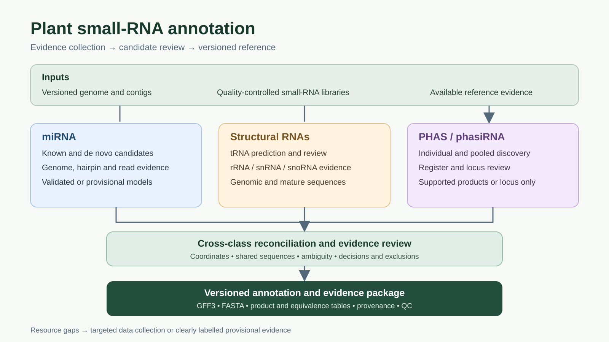

# Plant small-RNA annotation: an evidence-led curation strategy

This repository describes a transferable strategy for building a genome-anchored plant small-RNA annotation. It reconstructs the approach used for maize B73 RefGen_v5 and provides decision points for organisms with sparse reference annotations. It is a **methods and case-study repository**, not an automated end-to-end pipeline.

The vector figure can be downloaded and used in presentations. Its [accessible text description](docs/workflow.md) explains each step and the feedback loops.

## Start here

1. Read the [general workflow and evidence policies](docs/workflow.md).
2. Follow the [software setup guide](docs/setup.md) for miRador, miRScore, Phasis and structural-RNA tools.
3. Use the [resource decision guide](docs/resource_decisions.md) to plan species-specific data collection and identify missing evidence.
4. Consult the [B73v5 case study](case_studies/b73v5/README.md) for the documented tools, versions, policies, and historical scripts, and the [rice Nipponbare case study](case_studies/rice_nipponbare/README.md), which is in progress.
5. Use the [reusable scripts](scripts/README.md) for public-library curation, genome-wide structural RNA prediction and mapping QC.
6. Check the [decision log](docs/decisions.md) for dated project decisions and their reasons.
7. Review the [release checklist](docs/release_checklist.md) before sharing an annotation.
8. To run the workflow with an AI agent, or to learn it step by step, use the [plant sRNA annotation skill](skills/README.md) (prototype): a short map plus one guide per step, a glossary, an output-interpretation guide and a pitfalls list.

An AI agent or analyst should first inventory the actual assembly, public databases, annotation sources, and available small-RNA libraries for the target species. Evidence availability determines which branches can be completed. Record failed searches and limitations; do not treat a lack of a database hit as proof that a feature is absent.

## Scope and interpretation

Use [miRador](https://github.com/rkweku/miRador) **and** [ShortStack](https://github.com/MikeAxtell/ShortStack) **4.1.0 or newer** to generate plant miRNA candidates, then [miRScore](https://github.com/Aez35/miRScore) to evaluate suitable candidate mature/precursor models using individual small-RNA libraries. Enable ShortStack's de novo miRNA search with `--dn_mirna`; do not use `--nohp`. Use [Phasis](https://github.com/blakemeyerslab/Phasis) **2.8.4 or newer** for *PHAS* and *PHAS*-like locus discovery and classification. Phasis alone performs the phasing analysis; ShortStack 4 has no phasing scores. For structural RNAs, predict genome-wide first, with [tRNAscan-SE](https://github.com/UCSC-LoweLab/tRNAscan-SE) for tRNAs and a genome-wide [Infernal](https://github.com/EddyRivasLab/infernal) scan with the [Rfam](https://rfam.org/) structural subset for snRNAs, snoRNAs and rRNAs. Then compare with [RNAcentral](https://rnacentral.org/) records.

The workflow distinguishes computationally supported and provisional *MIR* models, structural RNA classes, phased loci, and register-supported phasiRNA products. A genomic interval enriched in a particular read length is not by itself a *PHAS* locus, and reads inside a *PHAS* interval are not automatically phasiRNAs. Identical sequences may arise from multiple loci or classes; retain that ambiguity instead of duplicating abundance.

Release the genomic annotation, sequence references, evidence tables, and exclusion decisions together. Genomic sequence and mature-product sequence can differ, such as post-transcriptional tRNA CCA addition; keep their intended uses explicit. Analysis of differential abundance is a separate downstream task.

## Status

The scripts in `case_studies/b73v5/scripts/` are historical maize-specific implementations, provided as auditable examples rather than species-independent tools. The scripts in `scripts/` are reusable components developed while extending the method to rice; together they are still not an end-to-end automated pipeline. Their input data are not bundled. Consult the original software licenses and source-data terms before redistributing dependencies or reference files.
