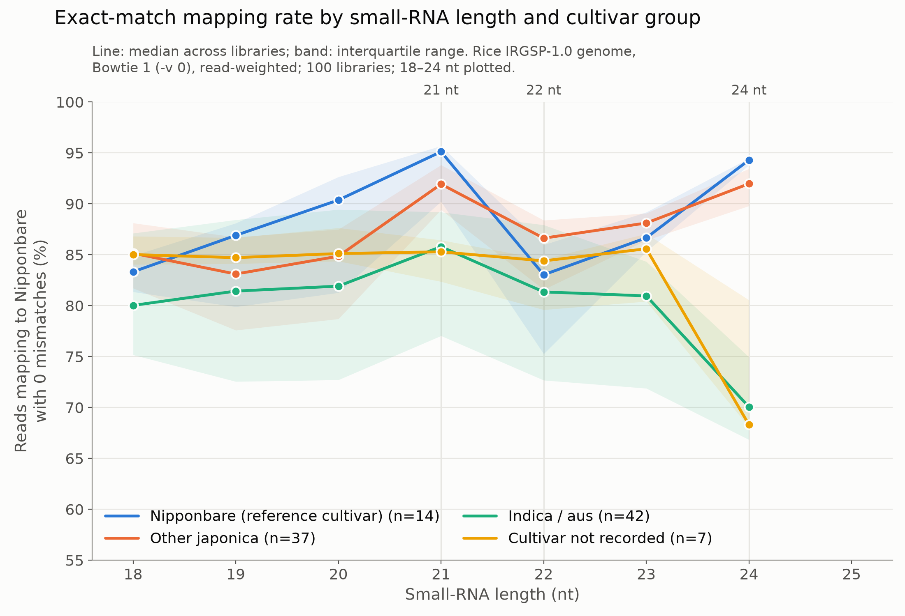

# Case study: rice (*Oryza sativa* Nipponbare), in progress

The second species annotated with this method, started 2026-11-06. This folder records decisions, provenance and small tables. Raw libraries, genomes and large outputs live on the analysis server and are not stored here. Project-wide decisions are in [`docs/decisions.md`](../../docs/decisions.md).

## Reference genome

- **File:** the PlantCAD2 rice FASTA, used as-is.
- **Contents:** 14 sequences, 374.5 Mb: Chr1–Chr12 plus `ChrUn` (634 kb) and `ChrSy` (592 kb). Uppercase, 165 kb N, no organelle genomes.
- **Identity:** IRGSP-1.0 in the MSU7 packaging, inferred from exact chromosome lengths (Chr1 = 43,270,923 bp) and MSU7 naming. Checksums are in [`tables/genome_checksums.tsv`](tables/genome_checksums.tsv).

## Comparison resources

Used for comparison with our predictions only, never as the starting point. Checksums are in [`tables/resource_checksums.tsv`](tables/resource_checksums.tsv).

| Resource | Version | Note |
|---|---|---|
| Rfam | 15.1 | structural subset of 827 families (`scripts/structural/`) |
| RNAcentral | release 28 (2026-10-07) | rice sequences and the IRGSP-1.0 coordinate file (chromosomes named `1`…`12`) |
| miRBase | v23.1 (`osa.gff3` dated 2026-09-16) | 516 *osa* hairpins; miRador bundles the older 22.1 |
| PmiREN | not used | consistent with B73v5 |
| Published PHAS catalogs | not used | only loci called in this study |

## Small-RNA libraries

- **Search:** GEO DataSets, searched 2026-11-06 with the queries in `tables/geo_query_*.json`. That gave 236 series and 3,135 samples.
- **Selection:** with `scripts/libraries/`, **100 libraries from 18 series, 1.34 billion reads** ([`tables/library_manifest.tsv`](tables/library_manifest.tsv)).
- **Exclusions:** every excluded sample is listed with its reason in [`tables/library_selection_v5.excluded.tsv`](tables/library_selection_v5.excluded.tsv); manual exclusions are in [`tables/manual_overrides.tsv`](tables/manual_overrides.tsv).

| Organ | Libraries | | Cultivar group | Libraries |
|---|---:|---|---|---:|
| Leaf | 24 | | Nipponbare | 14 |
| Panicle / inflorescence | 24 | | Other japonica | 37 |
| Seedling / shoot | 16 | | Indica / aus | 42 |
| Anther / meiocyte | 16 | | Not recorded | 7 |
| Seed (embryo, endosperm) | 9 | | | |
| Root | 6 | | | |
| Shoot base | 3 | | | |
| Callus | 2 | | | |

Problems found during selection, each now handled by an explicit rule:
- **Files that aren't raw read counts:** some contain normalized values (GSE58385), TPM tables of miRNAs only (GSE199238), or reads truncated to 20–21 nt (GSE118702).
- **Duplicates:** SuperSeries repeat their sub-series' samples (51 libraries), and two GSE107904 libraries were deposited again under GSE111440 with byte-identical content.
- **Mislabelled protocols:** degradome/PARE and csRNA-seq libraries filed under small-RNA strategies.
- **Mixed column orders:** count-first files (GSE149800) were converted to Phasis's sequence-then-count tag-count layout, preserving every read total.

### Exact-mapping check

Median fraction of reads mapping to Nipponbare with zero mismatches ([`figures/rice_exact_mapping_by_length.summary.tsv`](figures/rice_exact_mapping_by_length.summary.tsv); per library in [`tables/exact_mapping_qc_by_length.tsv`](tables/exact_mapping_qc_by_length.tsv)):

| Length | Nipponbare (n = 14) | Other japonica (n = 37) | Indica / aus (n = 42) | Not recorded (n = 7) |
|---|---:|---:|---:|---:|
| 21 nt | 95% | 92% | 86% | 85% |
| 24 nt | 94% | 92% | 70% | 68% |

The cultivar effect is largest at 24 nt. Indica libraries were kept because they provide roots and most vegetative tissues; their mapping rates are recorded per library and low-mapping libraries count as weaker evidence. Rates for reads longer than 24 nt are not genotype-driven: the reference lacks organelle genomes, so abundant organelle fragments cannot map.

## Structural RNAs, genome-wide (first results)

**tRNAscan-SE 2.0.13:**
- 733 tRNAs: 611 decoding the standard 20 amino acids, 12 pseudogenes, 31 with introns.
- 538 pass EukHighConfidenceFilter.
- 108 have mismatched isotypes and need review.

**Rfam 15.1 structural-subset `cmscan`:** 1,046 non-overlapping hits.

| Class | Hits |
|---|---:|
| C/D snoRNA | 562 |
| rRNA | 336 (234 of them 5S) |
| snRNA | 83 |
| H/ACA snoRNA | 65 |

- **Organelle-type rRNA:** 75 bacterial-model LSU/SSU hits, all on assembled nuclear chromosomes, in about 60 local clusters. Likely NUPTs/NUMTs; annotated as a separate class.
- **snoR71:** 157 hits, to be checked for repeat inflation.
- **Comparison with RNAcentral:** done afterwards. A first approximate pass with the RNAcentral coordinate file found RNAcentral support for all but 7 Rfam hits.

## Runs in progress

- **Queue:** one 32-core job at a time.
- **Phasis 2.8.4** (`90a3a0c`, `-mismat 0`, `-maxhits 25`): 21- and 24-nt runs on individual libraries, then pooled. The 21-nt individual, 24-nt individual and 21-nt pooled runs used separate run directories, so the index was rebuilt each time. From 2026-11-07 the pooled 24-nt run reuses the 24-nt run directory (`--outdir 24_results_pooled`), and later species use one run directory for all Phasis analyses (see `docs/decisions.md`).
- **ShortStack 4.1.2:** `--dn_mirna`, then a second run with `--known_miRNAs` from miRBase 23.1.
- **miRador:** Python 3.12 port.
- **miRScore 0.3.7:** evaluation of the predicted candidates comes after these runs.
