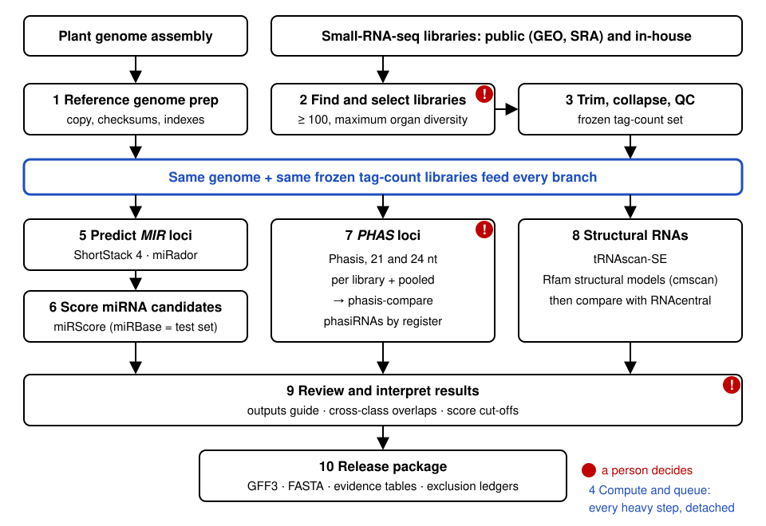

# Plant small-RNA annotation (Version 2 workflow)

This skill guides bioinformaticians, biologists and AI agents through a genome-wide plant small-RNA annotation: how to run each step, how to read the results, and how to avoid pitfalls that are likely to arise. Some of these pitfalls stop a run and can cost days. Others go unnoticed and lead to wrong interpretations, which is worse. This page is the map. Each step has its own **step guide** in `references/`; open a guide only when you reach that step, so you (or the agent) read only what is needed.

## What the workflow produces

For one plant genome, a set of genomic annotations supported by read evidence from small-RNA-seq libraries. Aim for **at least 100 libraries** covering as many organs, tissues and conditions as possible. More is better when diverse libraries exist; compute grows with library count. Public libraries (GEO, SRA) and **in-house or unpublished libraries** can be combined, as long as all go through the same processing ([02_library_sourcing.md](references/02_library_sourcing.md)).

| Class | Evidence | Main tools |
|---|---|---|
| miRNA genes (*MIR*) and their mature miRNAs | candidates predicted from the genome and the sRNA reads, not taken from databases; each candidate is then scored on every library (duplex structure, precision, read support) | ShortStack 4, miRador, miRScore |
| *PHAS* loci and their phasiRNAs (21-nt and 24-nt) | loci predicted from the sRNA reads, not from published catalogs: 21- or 24-nt sRNAs whose 5′ ends fall every 21 or 24 nt in one coherent register, with support at several phased positions (the footprint of a trigger cleavage followed by stepwise Dicer processing). Each candidate gets a statistical Phasis score and a Howell score, then its register structure is checked, which separates real loci from merely abundant or periodic regions such as 24-nt heterochromatic siRNA clusters. Weaker candidates are kept apart as *PHAS*-like. Details: [glossary.md](references/glossary.md); Cherubino Ribeiro et al. 2026, bioRxiv | Phasis |
| Structural ncRNAs: tRNA, rRNA, snRNA, snoRNA, organelle-type ncRNA | genome-wide covariance-model searches, then comparison with database records | tRNAscan-SE, Infernal + Rfam |

All branches use the same genome and the same tag-count libraries. Database records (miRBase, RNAcentral) are compared **after** prediction and never used as the starting point, because databases have gaps and their own errors.

New to the vocabulary? Read [glossary.md](references/glossary.md) first (about 10 minutes).

## The workflow at a glance

The figure is a vector file ([assets/workflow.svg](assets/workflow.svg)); its embedded description lists the same steps for readers who cannot see images. Red marks points where a person must decide.

## Step guide: which file to read

| Step | Step guide | Typical time (800 Mb genome, 100 libraries, 32 cores) |
|---|---|---|
| 1. Reference genome | [01_reference_genome.md](references/01_reference_genome.md) | minutes |
| 2. Find and select libraries (public and in-house) | [02_library_sourcing.md](references/02_library_sourcing.md) | 1-2 days, mostly review |
| 3. Trim, collapse, QC | [03_library_processing_qc.md](references/03_library_processing_qc.md) | hours (download-bound) |
| 4. Environments, compute, the run queue | [04_compute_and_queue.md](references/04_compute_and_queue.md) | setup 1-2 h |
| 5. Predict *MIR* loci | [05_mirna_prediction.md](references/05_mirna_prediction.md) | ShortStack 2.6-3 h per run; miRador about 1 h |
| 6. Score miRNA candidates with miRScore | [06_mirna_validation_mirscore.md](references/06_mirna_validation_mirscore.md) | 3-5 h per set |
| 7. *PHAS* loci with Phasis | [07_phas_phasis.md](references/07_phas_phasis.md) | 21 nt about 4 h; 24 nt more than a day (Phasis is being optimized) |
| 8. Structural RNAs | [08_structural_rna.md](references/08_structural_rna.md) | about 7 h |
| 9. Reading the outputs | [09_outputs_and_interpretation.md](references/09_outputs_and_interpretation.md) | |
| 10. Release | [10_release.md](references/10_release.md) | |
| Something went wrong | [pitfalls.md](references/pitfalls.md): symptom → cause → fix | |

## Rules that hold at every step

Breaking these rules silently corrupts results. Each one is explained in the step guide where it applies.

1. **One read set for every tool.** Each library becomes one tag-count file (`SEQUENCE<TAB>COUNT`, DNA letters, no header). Every tool's input is derived from that file, so all branches see identical reads.
2. **Exact matching.** Reads must match the genome with zero mismatches (Phasis `-mismat 0`, miRScore 0 mismatches). Libraries from non-reference genotypes therefore lose reads; measure the loss, do not hide it.
3. **Only small-RNA-seq.** Many SRA "miRNA-Seq" entries are long-RNA libraries. Check every library's size profile after trimming.
4. **Predict first, compare later.** miRBase and RNAcentral are comparison sets. miRBase is scored like any other set, not trusted as a positive control.
5. **Never modify source files.** Work on copies of the genome and downloads; record checksums of both.
6. **Record every decision with its reason and date.** Exclusions, dropped candidates and failed steps go in a log, never just deleted. Someone will ask why a library or a miRNA is missing.
7. **A computational pass is not experimental validation.** Say "supported by miRScore", not "validated".

## How an agent should work with this skill

- Before any step, inventory what actually exists (genome version, available libraries, in-house data, database entries). Missing evidence changes which branches can be completed; report the gaps.
- Check the server load before choosing thread counts, and run long jobs detached with a log and a status file ([04_compute_and_queue.md](references/04_compute_and_queue.md)).
- When a step fails, read its log first, then [pitfalls.md](references/pitfalls.md). Fix the pipeline (inputs, wrapper scripts, parameters); do not patch the third-party tools themselves. Write down any tool problem for its developers instead.
- Ask the person leading the project before swapping or dropping libraries, deleting large outputs, choosing score cut-offs, or running heavy jobs in parallel.
- When reporting, say plainly what ran, what failed and what was skipped. Label numbers "preliminary" until reviewed.

## Explaining results

When someone asks what a result means, answer in this order: what the file contains, what one row is, which columns matter, what a typical value looks like, and what it does **not** prove. Match the depth to the reader: biologists need the biological meaning and its limits, bioinformaticians also need the exact columns and thresholds. [09_outputs_and_interpretation.md](references/09_outputs_and_interpretation.md) covers every output, with example values from two annotated species (rice and tomato) for comparison.

## Defaults you may need to change

These defaults come from the project this skill was written for. These are guidelines, not requirements: adapt them to your data and computer, and record what you changed.

| Setting | Default | Why |
|---|---|---|
| Libraries per species | at least 100, maximum organ and tissue diversity; public and in-house combined | breadth of evidence; tissue-specific loci are missed when tissues are missing |
| CPU | about 32 cores per 100 libraries for heavy steps, one heavy job at a time on a shared server; the 24-nt Phasis runs benefit from more cores when the server is idle | Phasis dominates run time and is being optimized, so expect these figures to change |
| Genome | the plant genome assembly chosen for the study, with version and checksums recorded | every coordinate refers to it |
| Tool versions | Phasis 2.8.x-2.9.x (record the exact version and commit), ShortStack 4.1.2, miRScore 0.3.7, miRador Python 3.12 port, tRNAscan-SE 2.0.13, Infernal 1.1.4, Bowtie 1.3.1, Rfam 15.1, miRBase 23.1 | reproducibility |
| Polyploids | split subgenomes and treat each as a genome | homeolog multimapping breaks exact-match evidence |

The method's dated decision log is in the repository at `docs/decisions.md`. The reusable scripts named in the step guides are in `scripts/`.
